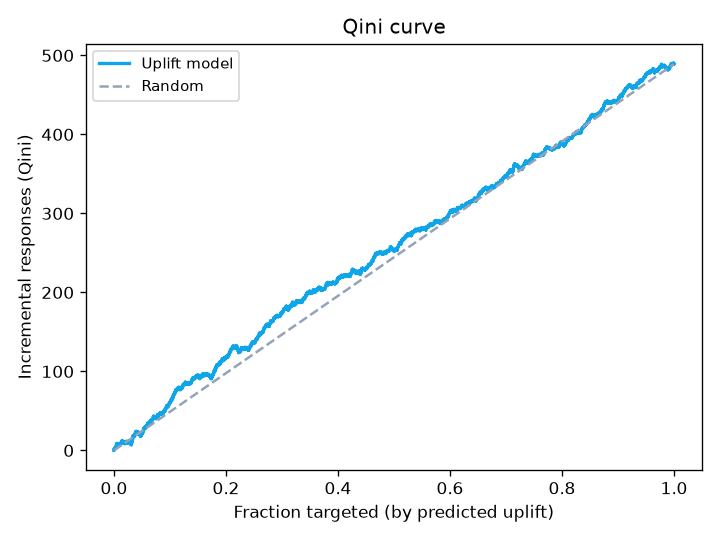

[](./README.md)
[](./README.en.md)

[](https://github.com/jusero1/churn-prediction-uplift/actions/workflows/ci.yml)
[](https://www.python.org/)
[](https://github.com/astral-sh/ruff)
[](./LICENSE)

# churn-prediction-uplift

> Who am I about to lose — and who is worth contacting? Propensity + survival +
> **uplift**, closing with a campaign simulation.

**Layer:** Model · **Axis:** Retention
`Python` `scikit-learn` `LightGBM` `lifelines` `uplift` `riskkit`



## 1. Business problem

Predicting churn is not enough. A customer who leaves no matter what, or stays no
matter what, is **wasted contact**. Profitable retention needs three answers:
**who** will leave (propensity), **when** (survival) and **who is worth
contacting** (uplift). This project builds all three and closes with a campaign
simulation that says how far to extend outreach.

## 2. Data

Two components, two real sources (uplift needs treatment/control, which a plain
churn dataset lacks):

- **Cell2Cell** (Teradata/Duke, 51,047 customers, churn 28.8%) → propensity and
  survival (`MonthsInService` as tenure).
- **Hillstrom / MineThatData** (a real randomized experiment, 64,000 customers) →
  uplift (Men's E-Mail vs. control; outcome = site visit).

Details and limitations in [docs/data_sources.md](docs/data_sources.md).

## 3. Methodology

Propensity with **LightGBM** (KS/Gini/AUC via
[`riskkit`](https://github.com/jusero1/riskkit)). Survival with **Kaplan-Meier**
and **Cox** (`lifelines`). Uplift with a two-model **T-learner**, evaluated with
**Qini** and **uplift by decile**. Explicit event and window definition in
[docs/metodologia.md](docs/metodologia.md).

## 4. Results

### Propensity and survival

| Propensity (test) | AUC | Gini | KS |
|---|---|---|---|
| LightGBM | 0.675 | 0.349 | 0.255 |

Median lifetime **34 months**. Cox — main risk drivers: `CustomerCareCalls`
(HR 1.008) and `DroppedCalls` (HR 1.005) **increase** churn; more
`MonthlyMinutes`/`MonthlyRevenue` **reduce** it. Bad experience → more risk.

### Uplift

Average effect of the e-mail on visits: **+7.7 pp**. Observed uplift by decile
concentrates the effect at the top:

| Decile (predicted uplift) | Observed uplift (treated − control) |
|---|---|
| **1** (highest) | **+9.5 pp** |
| 5 (middle) | +5.3 pp |
| 10 (lowest) | +7.0 pp |

## 5. Business translation

Campaign simulation (scenario: cost 0.40 per contact, value 5.0 per incremental
response):

| Fraction contacted | Incremental rate | Net value | ROI |
|---|---|---|---|
| Top 10% | 0.097 | +105 | 0.21 |
| **Top 30%** | **0.090** | **+198** | **0.13** |
| Top 50% | 0.079 | −43 | −0.02 |
| Whole base | 0.077 | **−224** | −0.04 |

**Contacting the top 30% by uplift maximises net value; contacting everyone loses
money.** That is the difference between predicting churn and deciding a campaign:
there are *sleeping dogs* you should not call.

## 6. Limitations and next steps

- **Subtle uplift:** the heterogeneous signal in Hillstrom is weak (small Qini);
  a property of the dataset, not the method.
- **Approximate survival:** cross-sectional snapshot with tenure, not a
  longitudinal cohort.
- **Modest propensity** (AUC 0.675): would improve with contract, bureau or
  transactional history; recalibrate for absolute-probability policy.

## 7. How to reproduce

```bash
make setup   # uv sync + pre-commit
make data    # Cell2Cell (Kaggle) + Hillstrom (direct) + checksum
make train   # models, metrics and figures -> reports/ and models/
make check   # ruff + pytest
```

## 8. Repository structure

```
churn-prediction-uplift/
├── src/churn_uplift/{data,models,evaluation}/  # pipeline + riskkit
│   └── models/{propensity,survival,uplift}.py
├── tests/                     # known-effect fixtures; CI never downloads data
├── notebooks/                 # 01_eda … 04_uplift_campaign
├── data/{raw,processed}/      # gitignored (licence + size)
├── models/                    # serialized artefacts (gitignored)
├── reports/figures/           # ROC, Kaplan-Meier, Qini, uplift, campaign
└── docs/                      # metodologia, model_card, data_sources, diccionario
```
