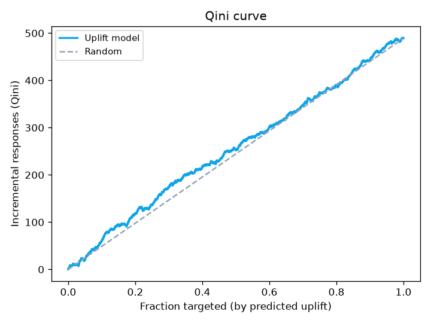

[](./README.md)
[](./README.en.md)

[](https://github.com/jusero1/churn-prediction-uplift/actions/workflows/ci.yml)
[](https://www.python.org/)
[](https://github.com/astral-sh/ruff)
[](./LICENSE)

# churn-prediction-uplift

> ¿A quién estoy a punto de perder — y a quién sirve contactar? Propensión +
> supervivencia + **uplift**, cerrando con una simulación de campaña.

**Capa:** Modelo · **Eje:** Retención
`Python` `scikit-learn` `LightGBM` `lifelines` `uplift` `riskkit`



## 1. Problema de negocio

Predecir la fuga no basta. Un cliente que se va haga lo que haga la empresa, o
que se queda de todos modos, es **contacto desperdiciado**. La retención rentable
necesita tres respuestas: **quién** se va (propensión), **cuándo** (supervivencia)
y **a quién sirve contactar** (uplift). Este proyecto construye las tres y cierra
con una simulación de campaña que dice hasta dónde ampliar el contacto.

## 2. Datos

Dos componentes, dos fuentes reales (el uplift exige tratamiento/control, que un
churn normal no tiene):

- **Cell2Cell** (Teradata/Duke, 51.047 clientes, churn 28,8 %) → propensión y
  supervivencia (`MonthsInService` como antigüedad).
- **Hillstrom / MineThatData** (experimento aleatorizado real, 64.000 clientes) →
  uplift (Men's E-Mail vs. control; outcome = visita).

Detalle y limitaciones en [docs/data_sources.md](docs/data_sources.md).

## 3. Metodología

Propensión con **LightGBM** (métricas KS/Gini/AUC vía
[`riskkit`](https://github.com/jusero1/riskkit)). Supervivencia con
**Kaplan-Meier** y **Cox** (`lifelines`). Uplift con un **T-learner** de dos
modelos, evaluado con **Qini** y **uplift por decil**. Definición explícita del
evento y la ventana en [docs/metodologia.md](docs/metodologia.md).

## 4. Resultados

### Propensión y supervivencia

| Propensión (test) | AUC | Gini | KS |
|---|---|---|---|
| LightGBM | 0,675 | 0,349 | 0,255 |

Vida media (mediana) **34 meses**. Cox — principales drivers de riesgo:
`CustomerCareCalls` (HR 1,008) y `DroppedCalls` (HR 1,005) **aumentan** la fuga;
más `MonthlyMinutes`/`MonthlyRevenue` la **reducen**. Mala experiencia → más
riesgo.

### Uplift

Efecto promedio del email sobre visitas: **+7,7 pp**. El uplift observado por
decil concentra el efecto arriba:

| Decil (uplift predicho) | Uplift observado (tratado − control) |
|---|---|
| **1** (más alto) | **+9,5 pp** |
| 5 (medio) | +5,3 pp |
| 10 (más bajo) | +7,0 pp |

## 5. Traducción a negocio

Simulación de campaña (escenario: costo 0,40 por contacto, valor 5,0 por
respuesta incremental):

| Fracción contactada | Tasa incremental | Valor neto | ROI |
|---|---|---|---|
| Top 10 % | 0,097 | +105 | 0,21 |
| **Top 30 %** | **0,090** | **+198** | **0,13** |
| Top 50 % | 0,079 | −43 | −0,02 |
| Toda la base | 0,077 | **−224** | −0,04 |

**Contactar el top 30 % por uplift maximiza el valor neto; contactar a todos
pierde dinero.** Ahí está la diferencia entre predecir churn y decidir una
campaña: hay *sleeping dogs* a los que no conviene llamar.

## 6. Limitaciones y siguientes pasos

- **Uplift sutil:** la señal heterogénea de Hillstrom es débil (Qini pequeño);
  propio del dataset, no del método.
- **Supervivencia aproximada:** corte transversal con antigüedad, no cohorte
  longitudinal.
- **Propensión modesta** (AUC 0,675): mejoraría con contrato, buró o histórico
  transaccional; recalibrar para política por probabilidad absoluta.

## 7. Cómo reproducir

```bash
make setup   # uv sync + pre-commit
make data    # Cell2Cell (Kaggle) + Hillstrom (directo) + checksum
make train   # modelos, métricas y figuras -> reports/ y models/
make check   # ruff + pytest
```

## 8. Estructura del repositorio

```
churn-prediction-uplift/
├── src/churn_uplift/{data,models,evaluation}/  # pipeline + riskkit
│   └── models/{propensity,survival,uplift}.py
├── tests/                     # fixtures con efecto conocido; la CI no descarga datos
├── notebooks/                 # 01_eda … 04_uplift_campaign
├── data/{raw,processed}/      # en .gitignore (licencia + tamaño)
├── models/                    # artefactos serializados (en .gitignore)
├── reports/figures/           # ROC, Kaplan-Meier, Qini, uplift, campaña
└── docs/                      # metodologia, model_card, data_sources, diccionario
```
